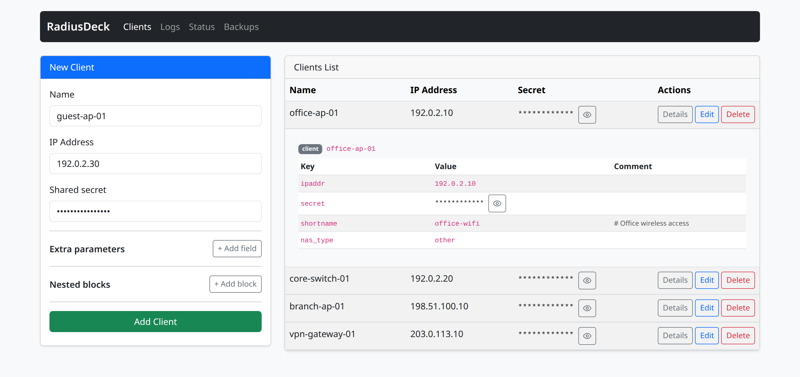

# RadiusDeck

RadiusDeck is a lightweight web interface for managing FreeRADIUS text
configuration. It edits `clients.conf` through a parser that preserves comments,
blank lines, ordering, and nested blocks.



*Community interface with fictional devices and masked shared secrets.*

### See it work with a real FreeRADIUS server

[host-demo.webm](https://github.com/user-attachments/assets/b65981c5-8291-4a85-804c-a89ee36bc71f)

In under a minute: add a client in RadiusDeck, restart FreeRADIUS, and get
`Access-Accept` from a test request. Then rotate the shared secret and roll it
back from a backup.
[Run the same demo on your machine](demo/README.md): it uses its own config
files and loopback ports, so your system FreeRADIUS is not touched.

## Included capabilities

- list, create, edit, and delete FreeRADIUS clients;
- automatic backups before configuration changes and rollback to the latest backup;
- safe basic log viewing with secret redaction;
- reload and runtime diagnostics for an optional sidecar;
- open or local authentication;
- a neutral extension interface for separately installed Python packages.

## Typical use cases

A RADIUS client is a device that sends requests to FreeRADIUS, such as a wireless
access point, switch, or VPN gateway. The **Clients** page manages these devices;
end-user accounts and authentication policies are configured separately in
FreeRADIUS.

These scenarios assume RadiusDeck is installed and connected to the
`clients.conf` used by your FreeRADIUS server. Sign in if local authentication
is enabled, using an account with permission to make configuration changes.

### Add an access point or VPN gateway

1. Open **Clients** and fill in the new client form:
   - **Name**: a descriptive name, such as `office-ap-01`.
   - **IP Address**: the source IP address FreeRADIUS will see for requests from
     the device. For example, `192.0.2.10` is an illustration; use your device's
     actual address.
   - **Shared secret**: a generated secret that you will also configure on the
     device.
2. Click **Add Client**. Confirm that the device appears in the client list and
   check any reload message.
3. Configure the device to use your FreeRADIUS server and the same shared secret.
4. Apply the configuration as described below, then test authentication from the
   device. Use **Logs**, when enabled, to help investigate failures.

Saving updates `clients.conf`. Automatic reload requires a configured sidecar
with `APP_SIDECAR_RELOAD_ENABLED=true`; otherwise, apply the change through your
normal FreeRADIUS reload or restart procedure. A successful save does not by
itself confirm that the running server has applied the change or that device
authentication succeeds. This also applies to edits and restores below.

### Change a device address or rotate its shared secret

1. Find the device in **Clients** and click **Edit**.
2. To change its address, update **IP Address**. Leave **Shared secret** blank
   to keep the current secret.
3. To rotate its secret, enter a new **Shared secret** and coordinate the same
   change on the device. Requests may fail while the two values differ.
4. Click **Save Changes**, check the reload result, and test the device again
   after applying the configuration.

For additional settings supported by your FreeRADIUS configuration, use
**Extra parameters** and **Nested blocks** in the same form. Editing merges
changes into the existing client block while preserving its retained comments
and the order of existing entries.

### Undo the latest configuration change

With automatic backups enabled and a recovery point available:

1. Open **Backups** and review the latest recovery point's time and reason.
2. Click **Restore latest**, review the confirmation, and click **Restore latest**
   again to proceed.
3. Return to **Clients** to check the restored configuration and review any
   reload warning.

Restoring replaces the entire `clients.conf`, including all clients, with the
latest recovery point. A safety backup of the current file is created first.
If reload fails, the restored file remains in place; resolve the reload problem
before expecting FreeRADIUS to use it. See [backups](docs/community/backups.md)
for storage and retention settings.

### Diagnose a change that has not taken effect

1. Review the message after saving: a reload failure can occur after the
   configuration file has already been saved.
2. Open **Status** to inspect configuration file access, backup storage, and
   the configured reload integration. Follow the remediation shown for a
   failed check.
3. If log viewing is enabled, open **Logs**, select the number of recent lines,
   and click **Refresh** after reproducing the problem on the device.

Log viewing requires `APP_FREERADIUS_LOG_VIEWER_ENABLED=true` and read access to
the file specified by `APP_FREERADIUS_LOG_PATH`. The page displays recent lines
from that file with secret redaction; available details depend on what
FreeRADIUS writes to the log.

## Requirements

- Python 3.12 or newer;
- a readable and writable `clients.conf`;
- optional access to a FreeRADIUS log file;
- optional access to a reload sidecar.

## Local installation

```bash
python -m venv .venv
. .venv/bin/activate
python -m pip install .
APP_ENV=development \
APP_RADIUS_CLIENTS_PATH=/path/to/clients.conf \
APP_BACKUP_DIR=/tmp/radiusdeck/backups \
radiusdeck serve
```

The server listens on `0.0.0.0:8000` by default. Use `--host` and `--port` to
override those values.

## Container build

The Dockerfile installs a tested wheel instead of copying the repository into
the image:

```bash
make test-community-artifact
docker compose build
docker compose up -d
```

Set `HOST_RADIUS_CLIENTS_CONF` to the absolute host path before starting the
Compose stack. The container runs as UID and GID `10001` and therefore needs
permission to read and update the mounted configuration and backup volume.
For HTTPS deployment, follow the certificate and reverse-proxy instructions in
[`deploy/certs/README.md`](deploy/certs/README.md).

## Configuration

Environment variables use the `APP_` prefix. Common settings are:

| Variable | Purpose | Default |
| --- | --- | --- |
| `APP_RADIUS_CLIENTS_PATH` | FreeRADIUS client configuration | `clients3.conf` |
| `APP_BACKUP_ENABLED` | Create recovery backups | `true` |
| `APP_BACKUP_DIR` | Backup directory | `/data/backups/clients` |
| `APP_AUTH_METHOD` | `none` or `local` | `none` |
| `APP_LOCAL_USERS_PATH` | Local user file | unset |
| `APP_SESSION_SECRET_KEY` | Session signing secret | unset |
| `APP_FREERADIUS_LOG_VIEWER_ENABLED` | Enable basic log view | `false` |
| `APP_FREERADIUS_LOG_PATH` | FreeRADIUS log file | `/var/log/freeradius/radius.log` |
| `APP_SIDECAR_RELOAD_ENABLED` | Call reload sidecar after writes | `false` |
| `APP_SIDECAR_RELOAD_URL` | Reload endpoint | unset |
| `APP_SIDECAR_RELOAD_TOKEN` | Reload bearer token | unset |

Local authentication requires both `APP_LOCAL_USERS_PATH` and
`APP_SESSION_SECRET_KEY`. Secure cookies are selected from `APP_PUBLIC_URL` and
can be overridden with `APP_SECURE_COOKIES`.

## Development checks

```bash
pytest tests
ruff check .
black --check .
mypy .
make test-community-artifact
make test-community-image
```

See [architecture](docs/community/architecture.md),
[backups](docs/community/backups.md), and the
[extension interface](docs/extensions.md) for the main runtime contracts.

## Contributing

See [CONTRIBUTING.md](CONTRIBUTING.md) for the development workflow and pull
request requirements. Report security vulnerabilities according to
[SECURITY.md](SECURITY.md).

## License

RadiusDeck is available under the [MIT License](LICENSE).
