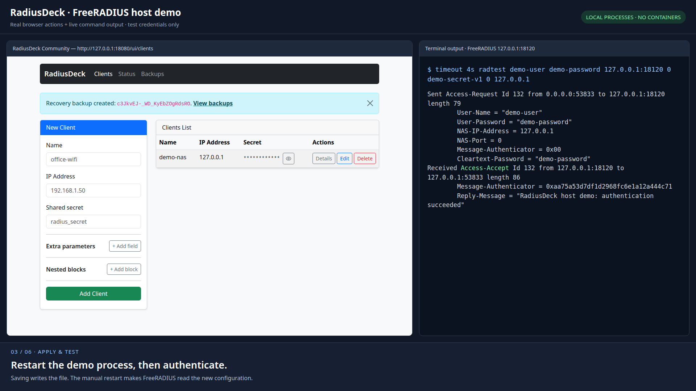

# Try RadiusDeck with a real FreeRADIUS server

[](../docs/community/media/host-demo.webm)

In this demo you add a RADIUS client in the browser, restart FreeRADIUS, and
send a test login with `radtest`. Then you change the client's shared secret
and roll the change back from a backup.

Everything runs on your Linux machine as two ordinary processes in your
terminals. The demo uses its own config files and loopback ports, so your
system FreeRADIUS, if you have one, is not touched. All names, passwords, and
secrets below are test values.

## What you need

On Ubuntu or Debian:

```bash
sudo apt install freeradius freeradius-utils python3-venv
```

This gives you FreeRADIUS 3.x, `radtest`, and Python virtual environments.
The package also starts a system FreeRADIUS service on port 1812. The demo uses
port 18120 and its own config, so you can leave that service running.

You also need Python 3.12 or newer, a browser, and free ports 18080 and 18120.
Other distributions and custom installations are covered in
[Non-standard FreeRADIUS installations](#non-standard-freeradius-installations).

Install RadiusDeck into a virtual environment from the repository root:

```bash
python3 -m venv .venv
.venv/bin/python -m pip install .
```

## Start the demo

You need three terminals, all opened in the repository root.

**Terminal A**: FreeRADIUS

```bash
bash demo/host/run-radius.sh
```

Wait for `Ready to process requests`. FreeRADIUS now listens on
`127.0.0.1:18120` and prints every request it receives.

**Terminal B**: RadiusDeck

```bash
bash demo/host/run-ui.sh
```

Open **<http://127.0.0.1:18080/ui/clients>**.

**Terminal C** is for test requests.

On the first run, the launchers copy the starting config from
`demo/host/config/` into `demo/host/.state/`. Your edits and backups are stored
there and survive restarts. To start over, see [Stop or reset](#stop-or-reset).

## Two different passwords

The demo uses two separate credentials. They are easy to mix up:

- **User account** `demo-user` / `demo-password`: the person who logs in. It is
  already defined in FreeRADIUS and is not managed by RadiusDeck.
- **Shared secret** `demo-secret-v1`: the key between FreeRADIUS and a network
  device (a RADIUS client). This is what you manage in RadiusDeck.

In this demo, `radtest` in terminal C acts as the network device.

## Walkthrough

Every test request uses this command. Only the secret changes between steps:

```bash
timeout 4s radtest demo-user demo-password 127.0.0.1:18120 0 demo-secret-v1 0 127.0.0.1
```

`radtest` takes the user name and password, the server address, a port number
(`0`), the shared secret, a PPP hint (`0`), and the device's own address. If no
reply arrives, `timeout 4s` stops it so you don't wait for retries.

### 1. Check that the request fails without a client

Run the command above in terminal C.

**This request is expected to fail.** FreeRADIUS does not know `127.0.0.1` yet,
so it ignores the request. After 4 seconds, `radtest` stops without a reply.

✅ Expected: no `Access-Accept`; terminal A shows `unknown client 127.0.0.1`.

### 2. Add the client and restart FreeRADIUS

In the browser, fill in the **New Client** form:

| Field | Value |
| --- | --- |
| Name | `demo-nas` |
| IP Address | `127.0.0.1` |
| Shared secret | `demo-secret-v1` |

Click **Add Client**. RadiusDeck saves the client to `clients.conf`. You can
look at the file:

```bash
cat demo/host/.state/config/clients.conf
```

FreeRADIUS reads `clients.conf` only at startup, so restart it. In
terminal A, press **Ctrl+C**, run `bash demo/host/run-radius.sh` again, and
wait for `Ready to process requests`.

Run the same `radtest` command in terminal C.

✅ Expected: `Received Access-Accept`.

> **Why the manual restart?** The demo has no automatic reload. In a real
> deployment, RadiusDeck can call a reload sidecar after each save; see
> [Configuration](../README.md#configuration). Without the sidecar, you restart
> or reload FreeRADIUS yourself, as in this demo.

### 3. Change the shared secret

Click **Edit** for `demo-nas`, set **Shared secret** to `demo-secret-v2`, and
click **Save Changes**. Restart FreeRADIUS in terminal A as in step 2.

Test the new secret:

```bash
timeout 4s radtest demo-user demo-password 127.0.0.1:18120 0 demo-secret-v2 0 127.0.0.1
```

✅ Expected: `Received Access-Accept`.

Now try the old secret, `demo-secret-v1`. FreeRADIUS drops requests with a wrong
secret instead of answering, so `radtest` stops after 4 seconds again.

✅ Expected: no `Access-Accept`; terminal A shows
`invalid Message-Authenticator`.

### 4. Roll back from a backup

RadiusDeck saved a backup before every change. Open **Backups**, click
**Restore latest**, check the backup's time and reason, and confirm with
**Restore latest**.

The latest backup is the config from before the secret change, so `demo-nas`
has `demo-secret-v1` again. Restart FreeRADIUS in terminal A and test with
`demo-secret-v1`.

✅ Expected: `Received Access-Accept`.

Restore replaces the whole `clients.conf`, not a single client. Before
restoring, RadiusDeck saves the current file as another backup, so the restore
can be undone too.

## Stop or reset

Press **Ctrl+C** in terminals A and B. Nothing else keeps running.

To start over with the original config, stop both processes and delete the
demo state:

```bash
rm -rf demo/host/.state
```

The next launch copies the starting config again.

This demo checks a simple username/password login against a local user list.
It does not set up Wi-Fi or VPN. Details about the recording are in the
[recording notes](../docs/community/media/host-demo.md).

## Non-standard FreeRADIUS installations

The launchers use these defaults. To change one, export the variable before
running the launcher that uses it: FreeRADIUS settings in terminal A, Python
in terminal B, and `DEMO_STATE` in both.

| Variable | Default | Purpose |
| --- | --- | --- |
| `DEMO_RADIUS_BIN` | `freeradius` | FreeRADIUS server binary, e.g. `/usr/sbin/radiusd` |
| `DEMO_RADIUS_LIBDIR` | `/usr/lib/freeradius` | FreeRADIUS modules |
| `DEMO_DICTIONARY_DIR` | `/usr/share/freeradius` | FreeRADIUS dictionaries |
| `DEMO_PYTHON` | `.venv/bin/python` | Absolute path to Python with RadiusDeck installed |
| `DEMO_STATE` | `demo/host/.state` | Absolute path for the working config and backups |

`DEMO_STATE` lets you keep a previous run and start a new one elsewhere, for
example `export DEMO_STATE=/tmp/radiusdeck-demo`. Terminals A and B must use the
same value.

<details>
<summary>Run the server without installing the FreeRADIUS package (Ubuntu)</summary>

The recording used this approach. It works only if the FreeRADIUS libraries,
dictionaries, and `radtest` are already installed, for example via
`freeradius-utils`. The commands download the `freeradius` package and unpack
it inside `demo/host/.state/`. Nothing is installed and no service is started.

```bash
mkdir -p demo/host/.state/packages demo/host/.state/runtime
(cd demo/host/.state/packages && apt-get download freeradius)
for package in demo/host/.state/packages/freeradius_*.deb; do
    dpkg-deb -x "$package" demo/host/.state/runtime
done
export DEMO_RADIUS_BIN="$PWD/demo/host/.state/runtime/usr/sbin/freeradius"
export DEMO_RADIUS_LIBDIR="$PWD/demo/host/.state/runtime/usr/lib/freeradius"
ldd "$DEMO_RADIUS_BIN"
```

If `ldd` reports `not found`, install the missing libraries first. Export the
two variables in terminal A before running `run-radius.sh`. Deleting
`demo/host/.state` also deletes the unpacked server.

</details>
